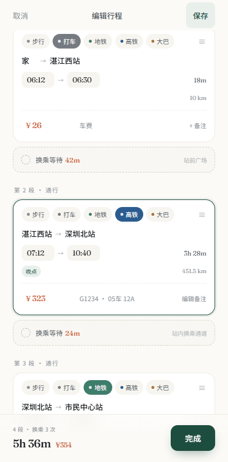
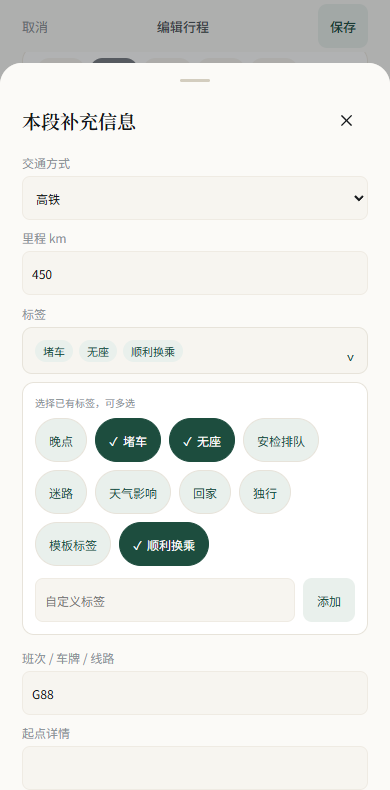
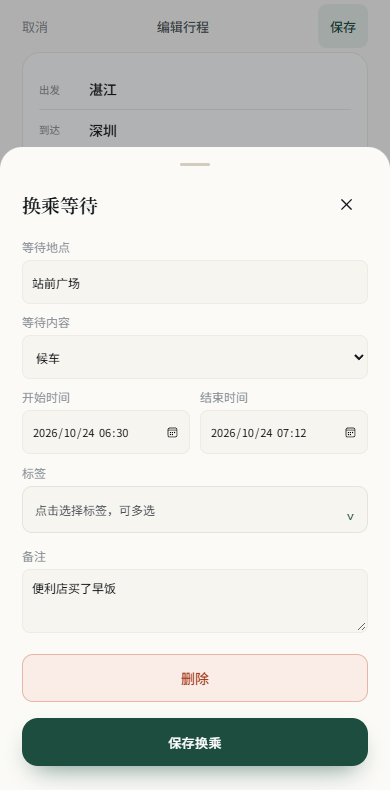
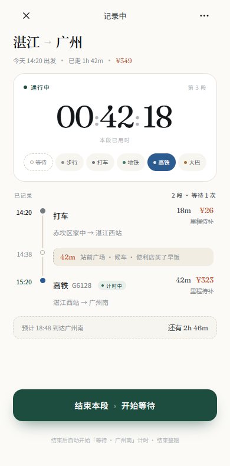

# 途迹 TripLog 1.1.3

按 [PRD](docs/PRD.md) 与 [UI 设计稿](docs/ui-design.html) 重做的离线 Android 出行手账。

[下载新版 APK](https://github.com/frozamina/triplog/raw/refs/heads/main/releases/TripLog-1.1.3.apk)

## 1.1.3 行程衔接与分段编辑

- 换乘次数按相邻通行段的衔接计算，高铁到地铁、地铁到高铁以及其他分段衔接均计入；每处衔接只计一次，不因多条等待记录重复累加。等待时长仍独立汇总。
- 首页行程右侧显示整趟里程；详情概览新增总里程，通行段右侧显示本段里程。未填写时显示缺失提示，不虚构距离。
- 编辑页支持长按通行段或等待段弹出“删除本段”，删除在保存整趟行程后生效。输入框仍可正常编辑，拖动把手保留排序。
- 编辑卡片直接展示备注里选中的标签。
- 本段补充信息按“交通方式 → 里程 km → 标签”排序，移除座位输入框；旧记录中的座位数据不被清除。备注及等待面板不再提供上移、下移按钮。



## 1.1.2 标签选择

- 标签输入改为可展开的多选列表，与“标签管理”共用预置和已用标签，支持多选、取消及自定义标签。
- 本段补充信息中的标签行位于交通方式正下方，选择标签不会清空其他已填字段。
- 整趟与换乘使用同样的选择器；详情页顶部标签可直接点击编辑。
- 保存的通行段、换乘段标签会直接显示在详情时间轴上，并计入标签管理频次。



## 1.1.1 修复

- 费用符号和输入框整体高亮，输入金额时不再被矩形焦点框压住。
- 上移、下移、删除改为三个 48px 高的显眼按钮，删除单独使用赤陶色。
- 步行显示“步行 · 免费”，不显示待补车费，也不计入缺失花费提醒；从收费方式临时切换再切回时保留已输入的金额。
- 首页普通行程和进行中行程均支持长按约 0.55 秒弹出删除菜单，无需进入详情；滑动取消长按，短按仍打开行程，删除前确认。



## 界面

直接复用设计稿的完整 CSS（`design-original.css`），按六个页面的结构实现动态界面。墨绿月度概览、进行中置顶卡、彩点方式链、白色实时计时卡、纵向轨道时间轴、段落编辑卡、四格 KPI、花费分布表、方式效率表和方案对比表均保留。Fraunces、Noto Sans SC、Noto Serif SC 随 APK 离线打包，许可随字体提供。

Android 使用系统状态栏和系统导航，不绘制设计展示用的 iPhone 外框、刘海和底部横条。底部采用设计稿的“行程 / 洞察 / 我的”三个 Tab，新建记录从加号进入。可编辑字段使用真实输入控件，其他信息收进补充面板。

页面中的数字从本机记录计算，首次安装没有虚构行程。截图使用独立测试数据，未打包进 APK。



[列表](docs/screenshots/home.png) · [详情](docs/screenshots/detail.png) · [编辑](docs/screenshots/editor.png) · [洞察](docs/screenshots/insights.png) · [对比](docs/screenshots/compare.png) · [我的](docs/screenshots/mine.png)

## 功能

- 按月分组的行程列表、搜索、进行中置顶和超过 24 小时待补全提示。
- 城市、地点详情、日期、标题、备注、标签；草稿、完成、复制与删除。
- 独立的通行段和换乘等待；时间接续、自动补齐相邻通行段之间的等待、跨天和重叠校验、拖动排序。
- 11 种交通方式，班次、起终点详情、里程、花费明细、备注及标签。
- 实时打卡计时卡、六个常用类型选项和更多方式、类型切换不重置开始时间、结束后立即开始下一段、预计到达。
- 超过 6 小时可按预计时间结束、继续计时或手动改时间，绝不自动结束。打卡结束提示待补花费。
- 时间轴、通行/等待构成、费用与里程指标；月度统计、方式效率、标签频次与条件洞察。
- 路线模板复用，同 OD 历史组合对比，最快/最省/最省心标记与省时成本。
- 标签重命名和移除，JSON 备份与合并恢复、CSV 明细和 PNG 分享卡片。

PRD 中列为远期的 P2（OCR、年度报告、同行分摊）不属于本版。

## 覆盖升级与数据

本版 `versionCode=5`、`versionName=1.1.3`，与 1.0.0 / 1.1.0 / 1.1.1 / 1.1.2 使用同一永久签名和包名 `com.frozamina.triplog`。数据库继续为 `triplog.db`，schema 2，`Store.java` 与上版相同，无删表、重建或初始化示例数据。

**直接安装新版 APK，选择更新。不要先卸载，也不要清除应用数据。** 建议升级前从“我的”导出 JSON 备份。手机损坏、重置、卸载、清数据或签名密钥丢失，不能通过 APK 更新机制兜底。

签名证书 SHA-256：
`a305517baa390cdbb8aa878cd269486bb073af8c93ce76539454e409f1d12b31`

签名私钥和密码单独交付，未上传本仓库。后续每版必须沿用同一密钥并递增 versionCode；GitHub Actions 没有配置密钥 Secrets 时不会生成替代签名。

## 构建

需要 JDK 17+、Python 3、Android SDK platform 35 / build-tools 35.0.0。

```sh
export JAVA_HOME=/path/to/jdk
export ANDROID_HOME=/path/to/android-sdk
export TRIPLOG_KEYSTORE=/secure/path/triplog-release.jks
export TRIPLOG_STORE_PASSWORD='your-store-password'
export TRIPLOG_KEY_PASSWORD='your-key-password'
export TRIPLOG_VERSION_CODE=6
export TRIPLOG_VERSION_NAME=1.1.4
python scripts/build.py
```

Windows 使用 PowerShell `$env:变量名='值'`。直接 SDK 构建不需要 npm 或 Gradle 运行依赖，产物在项目上一级；也可以用 Android Studio 导入 Gradle 工程。

GitHub Actions 手动构建需管理员配置 `TRIPLOG_KEYSTORE_BASE64`、`TRIPLOG_STORE_PASSWORD`、`TRIPLOG_KEY_PASSWORD` 三项 Secrets。第一项为已交付 JKS 的 Base64，不是新生成的密钥。

## 验证

```sh
node tests/core.test.js
# 下面仅用于界面测试，不是 APK 依赖
npm install --no-save playwright@1.62.1
npx playwright install chromium
node tests/ui.test.cjs
node tests/editor-gestures.test.cjs
node tests/tags.test.cjs
node tests/segments.test.cjs
```

已通过核心计算测试，以及 320/360/390/480 宽度下七个页面的检查。流程测试覆盖新建、分段、等待、保存、模板、计时卡、切换类型、页面重载恢复、接续、结束、超过 6 小时的处理、进行中编辑、标签管理及旧记录未知字段保留。测试夹具仅位于 `tests/fixtures/`。

APK 经 aapt2 / D8 构建、zipalign 对齐、apksigner v2/v3 验签，并核对新旧 APK 证书一致。**尚未连接安卓真机验证安装、系统文件选择器及覆盖升级。** 真机步骤见 [发布检查单](docs/RELEASE-CHECKLIST.md)。

## 存储约束

- 永久保留现有包名、签名和数据库文件名。结构变更使用增量迁移，不允许删表重建或自动降级。
- JSON 备份按 ID 合并，保留其他本机记录；原记录写入修订表，导入失败整批回滚。
- 金额按整数分聚合；等待与通行独立统计；没有里程时显示缺失指标，时间空隙不伪装成通行。
- 记录包含时间戳及录入时区偏移，展示按设备本地时间。
- 本地 WebView 只加载 APK 内资源，应用没有网络和定位权限。备份包含出行地点与时间，请妥善保管。
